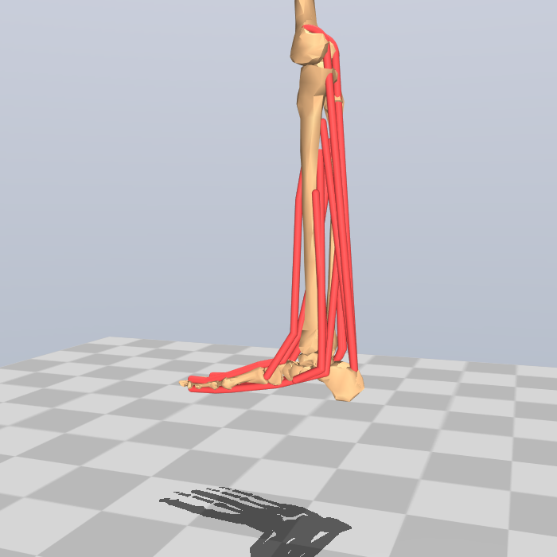
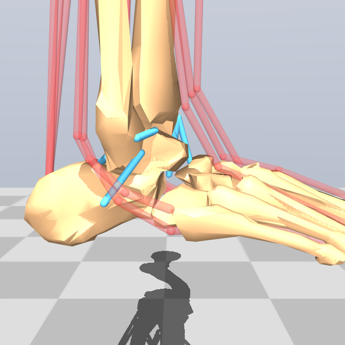
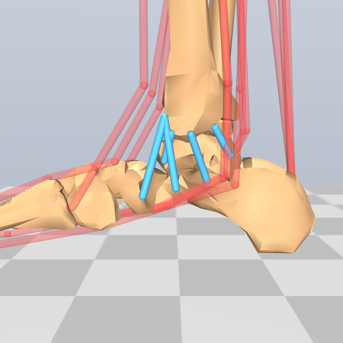
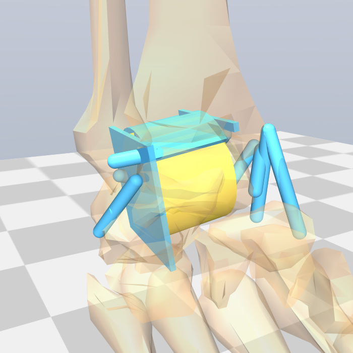

# Ankle–foot model (right side, MuJoCo)

A standalone shank–ankle–foot model, extracted from
[MS-Human-700](../MS-Human-700) and extended with the main ankle ligaments. It is the first building block of the LigaSys ankle digital twin.

## Branches

`main` is the **shared core**: the model builder, ligament data, the 6-DOF joint, the bench rig, the verifier and the benchmarks both lines of work use. Two long-lived branches build on it and are never merged back as a whole:
- **`ligasys-sprain`:** the inversion-sprain mechanism and Smart Ligament design. Disclosed, fitted parameters are allowed (currently a subtalar inversion stiffness fitted to Pellegrini 2016) along with the trapdoor rig.
- **`research-twin`:** a research-grade model for publication. No fits used as validation; the subtalar hinge is to be replaced with a contact joint.

**Workflow.**
- **Shared changes:** branch off `main`, PR into `main`, then merge `main` into both long-lived branches.
- **Branch-only changes:** branch off that branch and PR back into it.
- **Never open a PR from `ligasys-sprain` or `research-twin` into `main`.** It would carry branch-only fits into the shared core. Shared work done on a branch is cherry-picked onto a branch off `main`.
- **`docs/papers_needed.md`** is owned by each branch and is not changed on `main`.
- **Generated model XMLs:** on merge conflicts, rebuild them rather than editing.

**What `main` lacks on its own:** the cervical ligament is slack to 14° of subtalar inversion (Knudson 1997), and nothing else stiffens the subtalar hinge in inversion below that. At 4 N·m it sits near its 19.5° stop, so two Pellegrini checks are KNOWN on `main`. Each branch adds the missing stiffness.





## What it is

A bench-top rig. The femur is welded in place and the knee is locked at a chosen angle (0° by default). The foot hangs free. It is driven by the 11 muscles that cross the ankle and restrained by 8 ligament bundles.

| Part | Contents |
|---|---|
| Bodies | `femur_r` (fixed), `tibia_r` (tibia + fibula), `talus_r`, `calcn_r`, `toes_r` |
| Joints | `ankle_angle_r` (talocrural flexion, −39° … +30°, + = dorsiflexion) about a moving axis, via the coupled `ankle_axis_tilt_r` (see "Ankle axis"); `subtalar_angle_r` (±19.5°, + = inversion; the stop now stands in for the articular and capsular limit, see "Subtalar ligaments"); `mtp_angle_r` (±29°); knee DOF plus 5 coupled translation/rotation DOFs |
| Muscles | gastrocnemius med/lat, soleus, tibialis posterior, FDL, FHL, peroneus longus/brevis, tibialis anterior, EDL, EHL |
| Muscle model | MuJoCo Hill-type muscle, **rigid tendon**, parameters unchanged from MS-Human-700 (Rajagopal-lineage values) |
| Ligaments | ATFL (superior and inferior bands), CFL, PTFL; deltoid: tibionavicular, tibiospring, tibiocalcaneal, deep anterior and deep posterior tibiotalar; subtalar: cervical, interosseous talocalcaneal |
| Ligament model | straight-line spatial tendon with a **tension-only spring** (MuJoCo `springlength` deadband) plus light damping; linear, or an exponential toe-region curve built from parallel springs |

Geometry, joint axes, muscle paths and muscle strengths are copied **unchanged** from MS-Human-700. The six bone meshes are copied into `model/meshes/`, so the model folder is self-contained.

## Ligaments

All ligament data lives in [ligaments.py](ligaments.py), each value tagged with its source. Slack length is the model length at the ankle angle where the ligament is reported to become taut.

| Ligament | Force–strain | Taut from | Sources |
|---|---|---|---|
| ATFL, superior band | linear 22.35 N/mm | 16.2° PF | **half** of Rochelle 2020's whole-ATFL stiffness (split assumed); onset Ozeki 2002 |
| ATFL, inferior band | linear 22.35 N/mm | 0° | **half** of Rochelle 2020 (split assumed); isometric (Vega 2020), zero strain at neutral **assumed** |
| CFL | linear 45.8 N/mm | 17.8° DF | stiffness Rochelle 2020; onset Ozeki 2002 |
| PTFL | linear 59.0 N/mm | 18.0° DF | stiffness Rochelle 2020; onset Ozeki 2002 |
| TNL (tibionavicular) | linear 39.1 N/mm | 10° PF | stiffness Siegler 1988 (secondary); onset Takao 2020 |
| TSL (tibiospring) | linear 39.1 N/mm | 15° PF | stiffness **assumed = TNL**; onset Takao 2020 |
| TCL (tibiocalcaneal) | 0.51·(e^(45.99ε) − 1) N | 0° | curve Funk 2000 (secondary); onset Takao 2020 |
| dATTL (deep anterior tibiotalar) | 2.06·(e^(20.11ε) − 1) N | 0° | curve Funk 2000 (secondary); onset **assumed** |
| dPTTL (deep posterior tibiotalar) | 1.34·(e^(28.65ε) − 1) N | 0° | curve Funk 2000 (secondary); onset **assumed** |
| CL (cervical) | linear 63.9 N/mm | subtalar 14° inversion | stiffness and failure (163.5 N) Michels 2022; onset Knudson 1997 (indirect: unloaded lax zone) |
| ITCL (interosseous talocalcaneal) | linear 150 N/mm | subtalar 0° | stiffness, failure (382.5 N) and length (11.0 mm) Michels 2022, tested with the anterior capsular ligament; onset **assumed** |

**Two-band ATFL.** Vega 2020 found two ATFL bands in all 30 fresh-frozen specimens:
- **Superior band:** lengthens from 12.6 mm in DF to 19.2 mm in PF. The model's ATFL already behaved this way, so it keeps Ozeki's 16° PF onset.
- **Inferior band:** isometric at 10.6 mm. It shares its fibular origin with the CFL, to which it is joined by arciform fibres. In the model it runs from the anterior fibular border, 18.7 mm from the malleolar tip (the CFL's site before its correction; see "Attachment geometry" for why the ATFL origins have not moved), to the lateral talar vertex below the superior insertion whose length is closest to 10.6 mm, and it is taut from neutral.

Without it, the ATFL was slack at neutral and cutting it changed nothing, where Rasmussen 1982 measured internal rotation rising from 7° to 18°. Rochelle 2020 tested the whole ATFL, and Vega's Table 1 (band widths) was not available, so stiffness and failure load are split equally between the bands. The arciform coupling to the CFL is not modelled.

**Subtalar ligaments.** MS-Human-700's hard ±19.5° subtalar stop is kept as the bony limit. Sources and gaps:
- **Stiffness, failure loads, elongation at failure and lengths** are from Michels 2022 (accepted manuscript, 18 pairs).
- **CL insertion:** the calcaneal vertex whose length is closest to Poonja 2017's mean height of 11.1 mm. The model length is 12.3 mm at neutral.
- **CL onset, 14° inversion:** Knudson 1997's unloaded cadaver feet rotate 13–14 ± 7° into supination under about 0.2 N·m before reaching a stable zone, so the subtalar ligaments are slack over that range. Their screw axis is within about 13° of the model's hinge. At this onset the CL is 15.8 mm long, within 1 SD of Michels' 13.9 ± 2.1 mm measured at maximal passive tension. Taut from neutral (the previous assumption), the CL failed first in every sprain load case, at about 12° and 4–8 N·m: its failure load sits only 2.6 mm (13°) past its onset.
- **ITCL insertion:** the vertex closest to Michels' 11.0 mm (ACaL–ITCL complex); taut from neutral (assumed).
- **ITCL direction:** in this geometry it lengthens in eversion, because MS-Human-700's subtalar axis runs about 11 mm above the tarsal canal, through the talar body. Knudson 1997 found that cutting it adds about 4° of supination and no pronation, i.e. the opposite direction; Tochigi 2004 also puts it in inversion; older descriptions put it in eversion.
- **Subtalar inversion stiffness below 14°** is not provided on `main` (see "Branches").

**Lateral onsets.** Ozeki et al. 2002 calibrated each strain gauge with a tensile test of its own bone–ligament–bone unit, so their onsets are true zero-strain angles. They replace Takao 2021 (ATFL from 0°, CFL biphasic), whose strain changes had no zero-strain reference. Takeuchi 2021 also has the ATFL beginning to tense near 20° PF. With these onsets every lateral ligament is slack between about 16° PF and 18° DF.

**Exponential curves.** Each is a stack of parallel tension-only springs on the same path, with deadbands starting at 0, 2, 4, 6, 8 and 10% strain. The stack follows the published curve to within 5–14% up to 10% strain and continues linearly beyond. This keeps the model pure MuJoCo, with no callbacks, so it still runs on GPU.

**Secondary sources.** "Secondary" means the value was read from a later paper that cites the original:
- Funk's curve fits come from Table 1 of Xu et al. 2019.
- The tibionavicular 39.1 N/mm comes from both Shin et al. 2012 and Xu et al. 2019, each citing Siegler.

The original tables still need checking. The tibiospring stiffness is the one remaining assumption. Siegler 1988 reports the tibiospring among the strongest bands, so 39.1 N/mm is probably low.

**Attachments.**
- **Lateral ligaments:** found on the bone meshes by landmark rules, anchored to published distances where the mesh allows (Clanton 2015 via secondary summary).
  - **CFL:** the fibular origin is the point on the antero-inferior outline of the lateral malleolus 5.3 mm from its tip (Clanton 2015). The calcaneal insertion is the lateral-wall vertex nearest the point one in-situ length (29.9 mm, Ozeki 2002) from the origin, 40° behind the fibular long axis (Edama 2017: the modal 40–49° class of 80 feet; mean of the class midpoints 40.6°). The result is 31.2 mm long at 42°. It tightens in dorsiflexion (5.4 mm/rad on the Inman axes, 2.2 mm/rad on `original`), as Colville 1990, Ozeki 2002 and Sarrafian describe. The rate is about twice Colville's midsubstance gauge (about 6% strain from 20° PF to 20° DF against the model's 11%). With Ozeki's zero strain at 17.8° DF the CFL is 1.6 mm slack at neutral.
  - **Earlier CFL path:** until November 2026 the origin rule took the most anterior fibular vertex in a height band, which put it 18.7 mm from the tip. The ankle axis then passed through the middle of the ligament, so it was near-isometric over flexion.
  - **ATFL origins still use that band rule** and sit 22.5 mm (superior band) and 18.7 mm (inferior band) from the tip, against Clanton's 13.8 mm and a shared origin with the CFL (Vega 2020). Moving them tilts the ATFL 51° upwards with this mesh's talar insertion, so the talar footprint or the mesh's malleolar tip is also off. Open.
  - **Sensitivity:** whether the CFL tightens in dorsiflexion depends on where the ankle axis exits relative to its origin, within Inman's own spread (8 ± 5 mm anterior of the tip). Edama 2017, simulating an axis through the malleolar tips, found 20–39° ligaments tighten in dorsiflexion and 40–59° ones slacken.
  - **PTFL:** the coarse talus mesh does not resolve the lateral tubercle, so the insertion is the posterior-process vertex whose neutral length matches Ozeki 2002 (23.7 mm; the old rule gave 14.6 mm). Neutral lengths vs Ozeki: CFL +4%, PTFL 0%, ATFL **−29%** (14.1 vs 19.8 mm; de Asla 2009 measured 16.3 mm in vivo).
- **Deltoid:** placed from Campbell et al. 2014, Table I, read in full. Origins are the published offsets from the distal centre of the intercollicular groove. Insertions follow the published length and orientation, so TSL, TCL, dATTL and dPTTL reproduce Campbell's lengths exactly at neutral.
- **Tibionavicular exception:** its orientation row in Campbell's table is internally inconsistent (the direction components don't form a unit vector), so its insertion uses the navicular landmark instead. Its length is 31.5 mm vs the published 33.6 mm.
- **Mesh mismatch:** deltoid attachment points sit 4–9 mm from the nearest mesh vertex, a mismatch between published anatomy and the coarse MS-Human-700 meshes.

## Use

```bash
python -m venv .venv
.venv\Scripts\python -m pip install -r requirements.txt
.venv\Scripts\python build_ankle_model.py              # moving ankle axis, knee locked at 0°, with ligaments
.venv\Scripts\python build_ankle_model.py --knee-angle 30
.venv\Scripts\python build_ankle_model.py --free-knee
.venv\Scripts\python build_ankle_model.py --no-ligaments
.venv\Scripts\python verify_ankle_model.py
```

Other ankle axes and the experimental 6-DOF joint (described below):

```bash
.venv\Scripts\python build_ankle_model.py --swing-deg 20 --out model_swing20     # larger axis swing
.venv\Scripts\python build_ankle_model.py --axis inman --out model_inman         # fixed Inman axis
.venv\Scripts\python build_ankle_model.py --axis original --out model_original   # MS-Human-700's own axis
.venv\Scripts\python build_ankle_model.py --six-dof --out model_6dof             # 6-DOF joint, fixed Inman axis
.venv\Scripts\python verify_ankle_model.py model_inman\ankle_foot_r.xml
```

The 6-DOF joint needs a fixed axis (its trochlea is a cylinder about it), so `--six-dof` defaults to `--axis inman` and refuses `--axis moving`.

[bench.py](bench.py) is a small test rig for either build. It can hold the ankle and subtalar angles the way an examiner's hands would, apply heel, sole and foot loads, cut ligaments, and read out talar motion, ligament strain and contact force.

To view the model, drag `model/ankle_foot_r.xml` into MuJoCo's `simulate` viewer (`python -m mujoco.viewer`). Ligament sites are in site group 4.

`model/ankle_foot_r.xml` is generated. Change `build_ankle_model.py` or `ligaments.py` and rebuild instead of editing the XML.

## Verification (`verify_ankle_model.py`)

| Check | Result |
|---|---|
| Muscle–tendon lengths vs. the full 700-muscle model | identical (max diff 4e-16 m); over 420 poses with `--axis original`, over the 60 neutral-ankle poses otherwise (the muscles rotate about a different axis by design) |
| Muscle moment arms at neutral | printed against Klein 1996 with an RMS difference; signs checked. With the Inman-based axes, peroneus brevis is reported as a **KNOWN** discrepancy (see below) instead of failing the run |
| Moving axis (default build) | instantaneous axis inclination 11.3° → 18.1° → 22.7° from 35° PF through neutral to 25° DF; equals the Inman axis at neutral |
| Ligament springs are tension-only | matches k·max(0, L−L0) to 4e-15 N·m |
| Exponential spring stacks | follow the published Funk curves within 5–14% over 0.5–10% strain |
| Ligament lengths at neutral | TSL, TCL, dATTL, dPTTL equal Campbell 2014; TNL −6%; PTFL matches Ozeki 2002, CFL +4%; ATFL −29% |
| Ligament length trends | ATFL, TNL, TSL, dATTL lengthen in plantarflexion; PTFL in dorsiflexion; CFL and CL in inversion; TNL, TSL, TCL in eversion (ITCL not asserted; see "Subtalar ligaments") |
| Passive behaviour | the hanging foot rests at about 14° PF instead of on the −39° stop; ligaments resist both end ranges (2.7 N·m at 25° PF, 0.9 N·m at 25° DF) |
| Bahr 1997 benchmark (6-DOF builds) | ATFL and CFL force increases under the talar tilt (5.7 N·m) and drawer (80 N) tests at 10° DF – 20° PF; flexion trends asserted, magnitudes reported (see the 6-DOF section) |
| ATFL bands | superior band lengthens 4.8–5.8 mm from 20° DF to 30° PF; inferior band changes ≤ 1.2 mm (Vega 2020: 6.6 mm and isometric) |
| Rasmussen 1982 benchmark (6-DOF builds) | talar tilt and internal rotation at 1.5 N·m after serial ATFL/CFL/PTFL cuts. Intact tilt in range; tilt grows with each cut; cutting the ATFL raises internal rotation 10.3° → 24.0° (Rasmussen 7° → 18°). Intact tilt on `inman` is 11.0°, 1° over Rasmussen's range (**KNOWN**) |
| Pellegrini 2016 benchmark (6-DOF builds) | subtalar vs ankle share of inversion at 4 N·m, and CFL vs CL + ITCL sectioning. On `main` the subtalar magnitude, sectioning and (`original` axis) share checks are KNOWN: no subtalar inversion stiffness below the CL's 14° onset (see "Branches") |
| Sprain order (6-DOF builds) | quasi-static supination ramped 1 N·m at a time at 30, 20 and 10° PF, subtalar free; each ligament is cut at its reported failure load. An ATFL band must fail first |
| Stormont 1985 loaded stability (6-DOF builds) | 700 N axial load, 3 N·m inversion, lateral ligaments cut: the talus must stay seated. Passes on both axes with the anatomical mortise (0.1° tilt) |
| Colville 1990 benchmark (6-DOF builds) | lateral-ligament length change with flexion, 3 N·m inversion and 3 N·m internal rotation, subtalar locked. All pass on both axes |
| Forward dynamics | stable; knee lock holds; soleus plantarflexes, tibialis anterior dorsiflexes |

## Ankle axis (`--axis moving | inman | original`)

[ankle_axis.py](ankle_axis.py) offers three talocrural axes. The neutral pose is identical in all three; only how the talus rotates changes.

- **`moving` (default):** the Inman axis at neutral, with a coronal-plane inclination that changes continuously with flexion. The lateral end is lower in dorsiflexion than in plantarflexion, as Lundberg et al. 1989 found (quasi-static, 7 of 8 subjects).
  - **Mechanism:** a second hinge, `ankle_axis_tilt_r`, points inferiorly, perpendicular to the axis, through the same centre. It is coupled to the flexion angle by `tilt = c·flexion²`, the same polynomial-equality mechanism MS-Human-700 uses for its knee. Two hinges in series add their angular velocities, so the instantaneous axis tilts linearly with flexion. It is pure MuJoCo, so it still runs on GPU.
  - **Swing size:** a total of 14.4° across the flexion range (`--swing-deg`) gives 11.3° at 35° PF, 18.1° at neutral and 22.7° at 25° DF. External rotation dips by 2–4° at both ends as a second-order effect.
  - **Where 14.4° comes from:** it is **illustrative**. It is the difference between morphology-predicted dorsiflexion and plantarflexion axes for one participant in Wolf et al. 2022 (Fig. 5); Lundberg's own magnitudes were not available to me.
  - **Conflicting walking data:** Wolf et al. 2022, using bone pins during walking, found the **opposite** direction in 4 of 5 participants. Lundberg's pattern is quasi-static, so treat the moving axis as a quasi-static model.
- **`inman`:** the line through points 5 mm distal to the medial malleolar tip, and 3 mm distal + 8 mm anterior to the lateral tip (Inman 1976, secondary), on this model's own meshes. It passes through the midpoint of the tips, consistent with Lundberg 1989.
- **`original`:** MS-Human-700's own hinge (from the OpenSim gait models). It passes 2.5 mm from the midpoint of the tips but 13.8 mm posterior of the medial tip.

| | `original` | `inman` | `moving` (default) |
|---|---|---|---|
| External rotation / frontal inclination at neutral | 6.1° / 10.1° | 22.5° / 18.1° | 22.5° / 18.1° (inclination 11.3° → 22.7° over the range) |
| Muscle moment arms vs Klein 1996 (RMS) | 8.5 mm | 8.9 mm | 8.9 mm (same as `inman` at neutral) |
| Peroneus brevis at neutral | −6.0 mm (plantarflexor, as measured) | **+1.3 mm (weak dorsiflexor; Klein −9.9 mm)** | same as `inman` |
| Tibialis anterior / posterior moment arm (Klein 32.0 / −8.0) | 42.6 / −8.9 mm | 30.4 / −19.0 mm | same as `inman` |
| Ligaments over failure load within 25° PF – 20° DF | TNL at 25° PF (231 N vs 120 N) | none | none |
| Strain at 35° PF: ATFL / TNL / dATTL / dPTTL / TCL | 22 / 27 / 82 / 41 / 19% | 26 / 12 / 30 / 4 / 0% | 24 / 13 / 35 / 7 / 0% |
| PTFL strain at 25° DF | 2% | 4% | 5% |
| Ligaments that should tighten in DF but don't | TCL, dPTTL | TCL, dPTTL (near-isometric, < 1 mm/rad) | same as `inman` |
| Passive ligament moment at 25° PF | 12.8 N·m | 2.5 N·m | 2.7 N·m |

**Reading it.**
- **Ligaments favour the Inman-based axes.** In the normal walking range nothing exceeds its failure load, and the medial bands become near-isometric.
- **Moving vs fixed Inman.** Within the walking range the moving axis is nearly identical to fixed Inman: the coupled tilt is only ~1° at 25° PF. Toward the end of range it trades ATFL strain (26 → 24%) for deep anterior tibiotalar strain (30 → 35%).
- **Muscles are a wash.** Overall fit to Klein is similar, but tibialis anterior improves while tibialis posterior and the peroneals get worse.
- **Peroneus brevis is a known discrepancy.** Its sign flip is a real disagreement with Klein. The verification prints it as **KNOWN** for the Inman-based builds rather than failing the run.
- **No version brings end-range ATFL strain under ~20%.** Limitation 1 explains why part of this gap is about how strain is defined, not a model error.

## Experimental: 6-DOF talocrural joint (`--six-dof`)



**What changes.** The talus gains 3 translations, a tilt (+ = inversion) and an axial rotation (+ = internal), named `talus_tx/ty/tz_r`, `talus_tilt_r` and `talus_rot_r`. None of these has a spring of its own. They are restrained only by articular contact, the ligaments and the muscles. The distal fibula also becomes mobile (below). The image shows the earlier idealised geometry.

**Why the contact is built from primitives.** The MS-Human-700 meshes are visualisation meshes:
- The talus sits 6–10 mm inside the plafond and overlaps the fibula.
- MuJoCo collides meshes as convex hulls, which would fill the mortise.

**Anatomical mortise.** [talocrural.py](talocrural.py) builds the joint around the model's own ankle axis, with three anatomical features that each can be switched off:
- **Trochlea, wider in front.** A body of revolution about the ankle axis (radius measured from the tibia mesh: 20.7 mm for `original`, 22.1 mm for `inman`), 28 mm wide, with its lateral face inclined so the front is wider than the back. Hayes 2006 measured 29.9 ± 2.6 mm anteriorly and 25.2 ± 3.7 mm posteriorly (3D-CT, n = 21) on coronal sections 30° either side of the centre of a 20.7 mm dome, i.e. 20.7 mm apart: a 12.8° taper, all on the lateral side.
- **Pivot about the medial malleolus.** A 6 mm sphere on the talus near the top-medial corner (0.7 R above the axis) bears on a medial malleolar plate covering the anatomical facet. A sphere on a plane allows tilt and axial rotation about its centre but no medial slide. Radius and height are assumptions; at mid-height the joint locked (about 3° of tilt and rotation whatever was cut).
- **Mobile fibula.** The lateral malleolar plate, inclined to match the trochlea, sits on a distal-fibula body (0.25 kg) together with the ATFL, ATFLi, CFL and PTFL origins. It can translate along the ankle axis (100 N/mm) and rotate externally about the vertical (20 N·m/rad). These stiffnesses are assumptions bounded by in-vivo fibular travel (about 1.7 mm side to side and 9° of rotation across activities); syndesmosis stiffness data are still wanted.
- **Plafond:** 10 plates on a ±45° arc about the axis.

At zero offsets the joint is congruent, so it reproduces the hinge. Contact is frictionless, and all plates now use the default stiff cartilage contact (700 N: 0.04 mm penetration). The tuned compliant malleolar plates of the earlier idealised mortise are no longer needed.

**What it does well** (asserted in the verification; `inman` is the default with `--six-dof`):
- **Seating:** the talus stays seated under 700 N axial load (0.3 mm) and, once settled, under forefoot pushes and pulls. During the first 0.3 s a free foot swings into its range stop and the talus moves up to 2.5 mm; that impact is reported, not asserted. At the −39° plantarflexion stop on `inman` it settles 2.9 mm off centre (**KNOWN**): the overstretched deltoid (limitation 1) tilts it into inversion and the narrow back of the trochlea gives it room. Unloaded under gravity it moves 1.6 mm (`original`: 1.1 mm), both **KNOWN**: the lateral ligaments are slack in the hanging foot, so the deep anterior deltoid tilts the talus 7° into inversion until the ATFL catches. The model has no capsule or muscle tone to hold it.
- **Loaded stability (Stormont 1985):** with 700 N or 350 N axial load and the lateral ligaments cut, 3 N·m inversion tilts the talus 0.1°. With the idealised mortise it slid 16 mm medially and tipped to 45°.
- **Sectioning** moves in the right direction:

  | Test | `--axis original` | `inman` (default) |
  |---|---|---|
  | Anterior drawer of the lateral talus at 150 N, intact → ATFL (both bands) cut | 8.5 → 16.4 mm | 11.0 → 16.9 mm |
  | Talar tilt under 3 N·m inversion, intact → ATFL cut → ATFL+CFL cut | 9.8° → 16.4° → 35.4° | 13.3° → 17.9° → 37.9° |
  | Anterior drawer with 700 N axial compression | 1.6 mm | 1.7 mm |

**Rasmussen 1982 benchmark.** 1.5 N·m applied to the foot, ankle and subtalar held at neutral. Rasmussen loaded the talus directly with the subtalar joint nailed (n = 6 per plane, mean):

| | Talar tilt, `inman` | Talar tilt, `original` | Talar tilt, Rasmussen | Internal rotation, `inman` | Internal rotation, `original` | Internal rotation, Rasmussen |
|---|---|---|---|---|---|---|
| Intact | 11.0° | 8.0° | 6° (2–10°) | 10.3° | 9.7° | 7° |
| ATFL cut | 15.7° | 14.3° | 11° | 24.0° | 27.3° | 18° |
| + CFL cut | 30.1° | 25.1° | 19° | 23.7° | 28.0° | 21° |
| + PTFL cut | 40.2° | 40.1° | 46° | 23.9° | 28.0° | 26° |

- **Matches:** the size of the ATFL-cut step in tilt (+5–6°, Rasmussen +5°), and the ATFL as the main internal-rotation restraint.
- **Over-reads:** intact tilt on `inman` (11.0°, 1° above Rasmussen's 2–10° range, **KNOWN**; 8.6° before the CFL correction), tilt after the CFL cut (25–30° vs 19°), and internal rotation by 3–9°.
- **Why intact tilt rose:** the corrected CFL is 1.6 mm slack at neutral, so the talus tilts about 2° further before it engages. Nothing else in the model (no capsule) takes up that slack.

**Bahr 1997 benchmark.** Increase in ligament force (N) with the talocrural flexion held at each angle, `inman` axis. Bahr values are mean ± SD (n = 8):

| Test | Ankle | ATFL model | ATFL Bahr | CFL model | CFL Bahr |
|---|---|---|---|---|---|
| Talar tilt, 5.7 N·m supination | 10° DF | 32 | 26 ± 11 | 149 | 123 ± 54 |
| | 0° | 79 | 36 ± 17 | 146 | 81 ± 45 |
| | 10° PF | 98 | 64 ± 51 | 141 | 60 ± 31 |
| | 20° PF | 123 | 123 ± 107 | 125 | 32 ± 34 |
| Anterior drawer, 80 N | 10° DF | 72 | 33 ± 17 | 40 | 40 ± 17 |
| | 0° | 85 | 23 ± 14 | 17 | 15 ± 14 |
| | 10° PF | 85 | 34 ± 17 | 0 | 6 ± 8 |
| | 20° PF | 73 | 53 ± 68 | −2 | −3 ± 6 |

The model ATFL is both bands summed, as Bahr's transducer measured the whole ligament. 10 of 16 values fall within Bahr's mean ± 2 SD (9 of 16 on `--axis original`; before the CFL correction 9 and 11). Both flexion trends are right, and the CFL's drawer forces now match at all four angles. What's wrong:
- **The CFL is still overloaded under inversion, 1.2–4× Bahr** (it was 1.6–5×), most in plantarflexion. Bahr's buckle transducers may under-read, so the excess may be partly in the reference. Not resolved.
- **Drawer loads the ATFL 2–4× too much at neutral and in DF.** Bahr let the tibia rotate and the foot plate translate; here the tibia is fixed.

**Pellegrini 2016 benchmark.** 4 N·m inversion, ankle flexion held, subtalar free. The model's oblique subtalar hinge angle is projected onto the coronal plane (×0.79) to compare with Pellegrini's calcaneal rotation (n = 16, mean ± SD). On `main` the subtalar joint has no inversion stiffness below the CL's 14° onset (see "Branches"), so it sits near its stop and three checks are KNOWN:

| Ankle | Subtalar, `inman` | Subtalar, Pellegrini | Ankle (talar tilt), `inman` | Ankle, Pellegrini |
|---|---|---|---|---|
| 10° DF | 14.4° | 3.8 ± 1.4° | 9.3° | 6.4 ± 2.2° |
| 0° | 15.3° | 7.2 ± 1.7° | 9.9° | 10.4 ± 3.1° |
| 10° PF | 15.4° | 8.0 ± 2.2° | 10.6° | 13.1 ± 3.6° |
| 20° PF | 15.4° | 10.8 ± 2.6° | 10.8° | 14.7 ± 3.4° |

**Colville 1990 benchmark.** Strain gauges, subtalar joint screwed, 3 N·m moments; full text read. Model ATFL here is the superior band. On both axes the model reproduces:
- ATFL lengthening from 20° DF to 30° PF (+25% on `inman`; Colville +15%);
- the ATFL lengthening with inversion and with internal rotation at every angle;
- CFL lengthening with inversion at every angle.

The `original` axis's earlier failures at 20° DF (the talus sat 3–8 mm anterior with no load) are gone with the anatomical mortise. It misses:
- **CFL in flexion:** on the hinge path the CFL now lengthens toward DF as Colville found, but in this test the talus is free and the deltoid tilts it into inversion in plantarflexion, which lengthens the CFL again (**KNOWN**). Colville also saw a slight rise at 30° PF.
- **PTFL with inversion:** lengthens; Colville found a slight decrease.

**Why it is not the default:**
1. **It does not fix the end-range strain problem.** Flexion still happens about the same fixed axis. On the `inman` axis ATFL strain at 35° plantarflexion is about 25% (hinge 26%).
2. **Some of the mortise is assumed.** The pivot sphere's radius and height and the fibula's stiffnesses are assumptions; the taper is measured.
3. **The magnitudes are only partly validated.** Ligament forces are benchmarked against Bahr 1997 (above), with mixed agreement. Talar displacements have not been compared with cadaver data; the intact drawer (11 mm at 150 N) may be large for a healthy ankle.
4. **It is not robust to non-physical loads.** A pure generalized torque on `ankle_angle_r` with no joint compression subluxes the talus. Apply loads as forces (muscles, sole or heel forces), which also compress the joint.
5. **The extra DOFs carry assumed damping.** 200 N·s/m and 1 N·m·s/rad suppress an overshoot instability; this is not taken from literature.

**History: the idealised mortise and why it was replaced.** The previous joint was a plain cylinder between flat plates: a full-height lateral plate and a thin medial rim (0.85–1.0 R), both made compliant (contact time constant 0.08 s instead of 0.004 s) because stiff plates jammed axial rotation. It matched Rasmussen's unloaded tests but failed Stormont: under 700 N with the lateral ligaments cut, the talus slid about 16 mm medially under the rim and tipped to 45°. On the `ligasys-sprain` branch that mechanism drove the trapdoor rig to 26° of talar tilt with the ATFL and CFL past failure. Three geometric fixes each traded one benchmark for another (`inman`; unloaded tilt at 1.5 N·m intact / ATFL / +CFL / +PTFL cut; Rasmussen 6/11/19/46°):

| Change | Unloaded tilt | Internal rotation, intact → ATFL cut (Rasmussen 7 → 18°) | 700 N, lateral cut |
|---|---|---|---|
| Thin rim (0.85–1.0 R) | 8.7/9.9/27.8/40.1° | 6.5 → 17.6° | 45° (dislocated) |
| Medial facet to 0.70 R | 7.6/7.7/28.5/37.4° | 2.5 → 2.6° (locked) | 0.0° |
| Medial facet 0.70 R, both facets short front to back | 8.3/9.3/27.8/40.1° | 6.0 → 6.1° (not ligament-limited) | 0.0° |
| Medial-lateral slide limited to ±3 mm | 8.7/9.9/11.1/11.1° | 6.5 → 12.4° | 0.0° |
| **Anatomical mortise (current)** | **8.6/11.5/30.1/40.2°** | **9.9 → 22.0°** | **0.1°** |

Each feature alone fell short: the pivot at mid-height locked the joint; pivot alone near the top kept the ATFL from controlling rotation (5.5 → 6.5°); fibula and taper without the pivot tipped the loaded intact talus to 25°. All three together give unloaded laxity and loaded stability. Setting `medial_pivot_radius = 0`, `trochlear_width_difference = 0` and `fibula_mobile = False` recovers the idealised mortise.

## Known limitations: read before using ligament forces

1. **Ligament strains at end range are still too high** (default moving axis).
   - **At 35° plantarflexion:** ATFL ≈ 24%, dATTL ≈ 35%, TNL ≈ 13%.
   - **At 25° dorsiflexion:** PTFL ≈ 5%.
   - **Forces:** at full plantarflexion the TNL exceeds its reported failure load. Within 25° PF – 20° DF no ligament does. (With `--axis original`, the TNL already exceeds its failure load at 25° PF.)

   **Two kinds of measurement disagree.**
   - **Attachment-to-attachment length (de Asla 2009, in vivo):** the ATFL lengthens about 7 mm from full DF to full PF. The model matches this (7.4 mm).
   - **Midsubstance strain gauges (Ozeki 2002; Renström 1988):** only 1.6 mm (ATFL) and 1.2 mm (PTFL) over the whole range.

   A single straight line through the footprint centres reproduces the first and so overstates fibre strain. Recruiting fibres in sequence would reconcile them. The ATFL is now two bands (Vega 2020). The superior band still carries the centroid strain, about 24% at 35° PF. Per-band stiffness, from Vega's Table 1 or Dalmau-Pastor 2023, would refine this further. **Use ligament length/strain *trends* and onsets; treat force magnitudes near end range with caution.**
2. **Structures that should tighten in dorsiflexion:** with the Inman-based axes, TCL (Takao 2020) and dPTTL (anatomy) are near-isometric (< 1 mm/rad) rather than tightening. The verification prints this as a NOTE. (The CFL was on this list until its attachments were corrected.)
3. **Axis choice drives most of 1 and 2.** On the original axis (13.8 mm posterior of the medial malleolar tip), the short medial bands lie *anterior* of the axis and are stretched hard in plantarflexion.
   - **The Inman-based axes fix the medial side**, at the cost of different muscle moment arms: peroneus brevis flips sign, a KNOWN discrepancy.
   - **The moving axis adds only the coronal tilt Lundberg describes.** It doesn't resolve the ATFL/PTFL end-range strain. That likely needs a richer axis motion (translation, transverse rotation) or subject-specific geometry. The experimental 6-DOF joint does not help with this.
4. **The talocrural joint is a hinge** (with a moving axis) in the default build. Ligaments attached to the talus can't sense inversion or eversion, and there is no anterior drawer or talar tilt. The experimental `--six-dof` build adds these, on a fixed axis.
5. **The ligament model is simplified.**
   - The lateral ligaments and TNL/TSL are linear, with no toe region (TCL, dATTL and dPTTL have Funk's exponential toe region).
   - There is no pre-strain distribution across fibres.
   - Paths are straight lines with no wrapping over bone.
   - The superficial posterior tibiotalar band, present in 79% of Campbell's specimens, is not modelled.
6. **Rigid tendons and no contact.** There is no Achilles compliance, no cartilage contact and no ground contact (the floor is visual only).
7. Right side only, generic adult anatomy, low-poly meshes (landmark error of a few mm).
8. **Inversion is not yet biofidelic.**
   - **Subtalar joint:** still MS-Human-700's 1-DOF hinge (axis through the talar body, about 11 mm above the tarsal canal). On `main` nothing but the CFL resists inversion below the CL's 14° onset; each branch adds the missing stiffness (see "Branches").
   - **Talar tilt (6-DOF build) is slightly lax.** Intact tilt is 11.0° at 1.5 N·m on `inman` (Rasmussen 1982: 2–10°; `original` 8.0°), because the CFL is slack at neutral and the model has no capsule. An earlier "too lax" conclusion rested on Choisne 2013 and is withdrawn.
   - **Internal rotation follows Rasmussen 1982** (10.3° intact, 24.0° with the ATFL cut, against 7° and 18°) with the anatomical mortise: a pivot about the medial malleolus, a trochlea wider in front and a mobile fibula. The pivot geometry and the fibula's stiffnesses are assumptions; segmented articular surfaces would replace them.
   - **Loaded stability (Stormont 1985) holds:** under body-weight axial load the talus stays seated in inversion even with the lateral ligaments cut.
   - **The CFL is still 1.2–4× Bahr 1997 in talar-tilt tests,** and tilt after the CFL is cut over-reads Rasmussen (30.1° vs 19°).
   - **The subtalar joint is the wrong kind of joint for the CFL.** In a 1-DOF oblique hinge, the near-parallel CFL has a 3 mm moment arm, so the cervical ligament does the CFL's job (Pellegrini). A subtalar joint with calcaneal rotation about the AP axis and translation, as in the 6-DOF talocrural joint, is the structural fix.
   - **Inferior ATFL band assumptions:** stiffness and failure load are split equally with the superior band, and it has zero strain at neutral. It stretches 1.5–2.5 mm at the extremes of flexion on the moving axis.
   - **Injury-event inversion:** the hindfoot cannot reach it (mean peak about 67° foot-to-shank, Lysdal 2022). The model has no midfoot joint to carry the rest.

The experimental 6-DOF joint (above) addresses limitation 4. It does **not** fix 1 or 2: flexion still happens about the fixed axis.

## References

- Rochelle D. et al. (2020) *J Mech Behav Biomed Mater* 102:103473. doi:10.1016/j.jmbbm.2019.103473: ATFL/CFL/PTFL stiffness and failure loads at 100 %/s.
- Takao M. et al. (2021) *BMC Musculoskelet Disord* 22:558: ATFL and CFL strain changes (onsets superseded by Ozeki 2002).
- Ozeki S. et al. (2002) *Foot Ankle Int* 23(9):825–832: zero-strain onset angles (ATFL 16.2° PF, CFL 17.8° DF, PTFL 18.0° DF), in-situ lengths and length changes (author's thesis summary; journal tables not yet checked).
- Bahr R. et al. (1997) *Acta Orthop Scand* 68(5):435–441: ATFL/CFL force increases in drawer and talar-tilt tests (Tables 2–3), read in full text.
- Colville M.R. et al. (1990) *Am J Sports Med* 18(2):196–200: lateral-ligament strain vs flexion with 3 N·m inversion, eversion and rotation moments, subtalar fixed (Figs 1–3), read in full text.
- Michels F. et al. (2022) *Foot Ankle Surg* 28(7):1014–1020: stiffness, failure load, elongation at failure and in-situ length of the CFL, cervical ligament and ACaL–ITCL complex (accepted manuscript).
- Knudson G.A. et al. (1997) *Acta Orthop Scand* 68(5):442–446: subtalar stable and transition zones under ~0.2 N·m circumferential load, before and after ITCL section (full text).
- Hayes A., Tochigi Y., Saltzman C.L. (2006) Ankle morphometry on 3D-CT images. *Iowa Orthop J* 26:1–4: talar-dome widths 29.9 / 27.9 / 25.2 mm anterior / middle / posterior on ±30° oblique sections, dome radius 20.7 mm (n = 21; full text). An earlier version of this README attributed these values to the wrong DOI.
- Stormont D.M. et al. (1985) *Am J Sports Med* 13(5):295–300: under physiological load the articular surfaces give all inversion-eversion stability (abstract).
- Poonja A.J. et al. (2017) *Cureus* 9(6):e1382: cervical ligament dimensions; ITCL fibre direction (full text).
- Vega J. et al. (2020) *Knee Surg Sports Traumatol Arthrosc* 28:8–17: superior ATFL band lengthens 12.6 → 19.2 mm from DF to PF; inferior band isometric (10.6 mm), sharing its fibular origin with the CFL (accepted manuscript read; Table 1 missing).
- Rasmussen O., Tovborg-Jensen I. (1982) *Acta Orthop Scand* 53:155–160: talar tilt and rotation at 1.5 N·m after serial lateral-ligament cuts, read in full text.
- Pellegrini M.J. et al. (2016) *J Bone Joint Surg Am* 98:842–848: subtalar vs ankle share of hindfoot motion at 4 N·m; CFL/CL/ITCL sectioning, read in full text.
- Choisne J. et al. (2013) ISB congress abstract (superseded as a benchmark by Pellegrini 2016): subtalar and talocrural inversion at end range, intact and after CFL / cervical / ITCL sectioning (Table 1).
- Tochigi Y. et al. (2004) *Foot Ankle Int* 25(8):588–596: ITCL keeps the subtalar joint apposed and resists lateral-to-medial drawer (abstract).
- de Asla R.J. et al. (2009) *J Orthop Surg Res* 4:7: in-vivo ATFL/CFL attachment-to-attachment lengths at five positions, read in full text.
- Takeuchi Y. et al. (2021) *BMC Musculoskelet Disord* 22:208: ATFL strain probe; tension begins near 20° PF, peaks in inversion.
- Lysdal F.G. et al. (2022) *Sports Biomech*: pooled kinematics of 24 recorded ankle sprains (abstract).
- Takao M. et al. (2020) *BMC Musculoskelet Disord* 21:289: superficial deltoid strain onsets (TNL 10° PF, TSL 15° PF, TCL 0° into DF), read in full text.
- Campbell K.J. et al. (2014) *J Bone Joint Surg Am* 96(8):e62: deltoid band footprints, orientations and lengths (Table I), read in full text.
- Funk J.R. et al. (2000) *J Biomech Eng* 122:15–22: exponential force–strain fits for TCL, anterior and posterior tibiotalar (via Table 1 of Xu C. et al. 2019, *J Orthop Surg Res* 14:114).
- Siegler S., Block J., Schneck C.D. (1988) *Foot Ankle* 8:234–242: tibionavicular stiffness 39.1 N/mm, failure 120 N (via Shin et al. 2012 and Xu et al. 2019).
- Clanton T.O. et al. (2015) *J Bone Joint Surg Am*: lateral ligament footprint distances (via secondary summary).
- Edama M. et al. (2017) *J Foot Ankle Res* 10:60: angle of the CFL to the fibular long axis in 81 feet, and its simulated strain over flexion and inversion by angle class (open access, full text).
- Inman V.T. (1976) *The Joints of the Ankle*: empirical axis 5 mm distal to the medial malleolar tip; 3 mm distal and 8 mm anterior to the lateral tip (via a functional-anatomy text).
- Lundberg A. et al. (1989) *J Bone Joint Surg Br* 71(1):94–99: axes lie close to the midpoint of the line between the malleolar tips, change through the range of motion, are oblique downward and laterally in dorsiflexion, and differ between individuals (abstract).
- Wolf P. et al. (2022) *Sci Rep* 12:13957: bone-pin walking data; the dorsiflexion/plantarflexion inclination difference runs opposite to Lundberg in 4 of 5 participants; source of the illustrative 14.4° swing (Fig. 5, morphology-based axes for one participant).
- Klein P., Mattys S., Rooze M. (1996) *J Biomech* 29:21–30: in vitro ankle and subtalar muscle moment arms (via Brookbush Institute review).

## Licence

Model data derived from MS-Human-700 (© LNS Group, Apache-2.0). Cite Zuo et al., ICRA 2024 (see `../MS-Human-700/README.md`).
